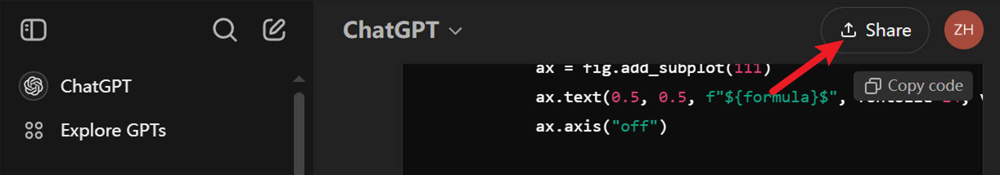
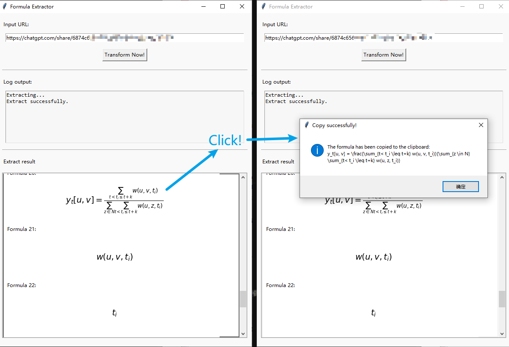

# Extractor de fórmulas matemáticas

Una herramienta sencilla para extraer fórmulas de sitios web.

## Fórmulas matemáticas para ChatGPT

Cuando interactuamos con ChatGPT, este muestra algunas fórmulas matemáticas que se renderizan mediante Katex. Por lo tanto, resulta difícil para nosotros copiar la fórmula y usarla en nuestros trabajos.

Por eso, esta herramienta proporciona un método para extraer las fórmulas fácilmente.

### Uso

1. Habla con ChatGPT. Verás que muestra algunas fórmulas matemáticas.

2. Comparte esta conversación, lo que hará que tu charla sea pública.

<div align=center>
    
</div>


<div align=center>
    
</div>

3. Usa el comando: ```python run.sh``` o descarga el archivo exe desde Releases para obtener el programa (Solo para Windows).

4. Copia el enlace e ingrésalo en el campo de texto de URL, luego haz clic en el botón de "Transform Now!".

5. Obtendrás la fórmula original en formato markdown/latex después de 20 ~ segundos (dependiendo de tu red). ¡Haz clic en la fórmula para copiarla!

<div align=center>
    
</div>

### Preguntas frecuentes (FAQ)

1. Obtienes el error: Respecto a MSEdgeDriver, que no se puede encontrar.

    Puedes descargar el controlador desde [este sitio web](https://developer.microsoft.com/en-us/microsoft-edge/tools/webdriver) (se recomienda usar Chrome para abrirlo) y agregarlo a tu variable de entorno PATH.
